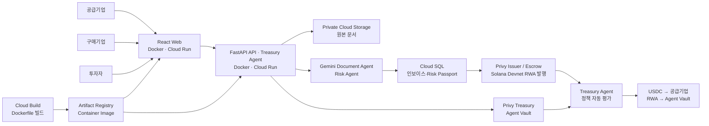
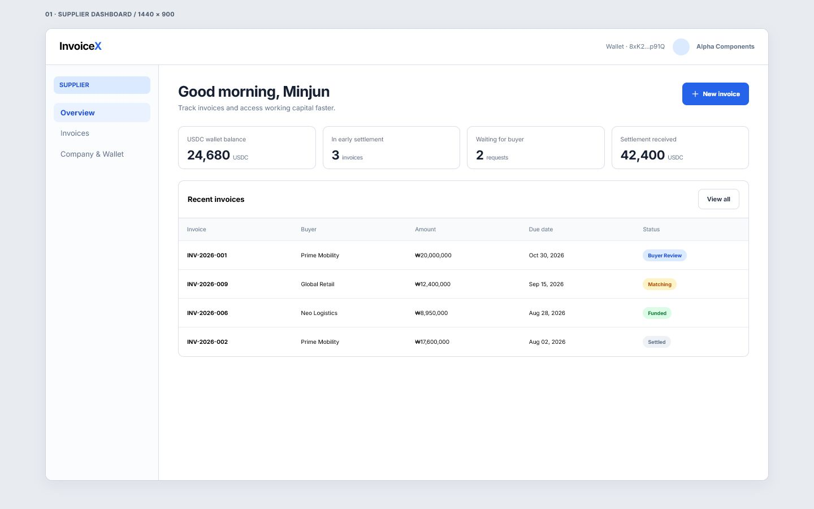
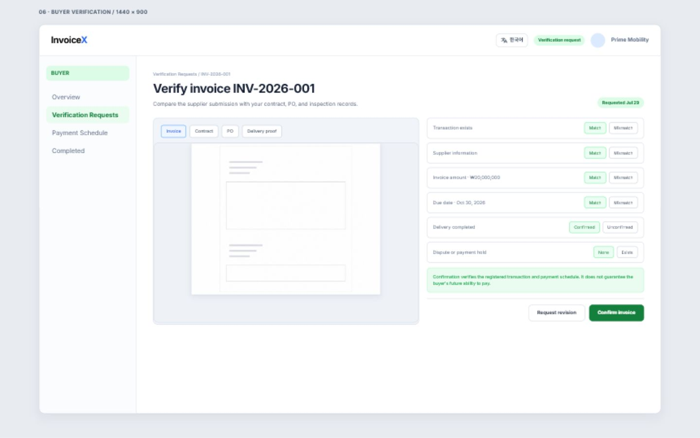
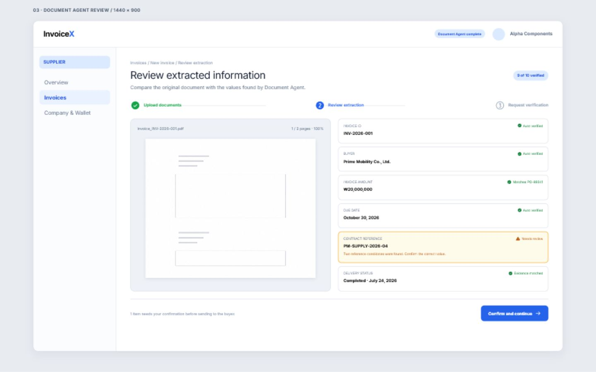
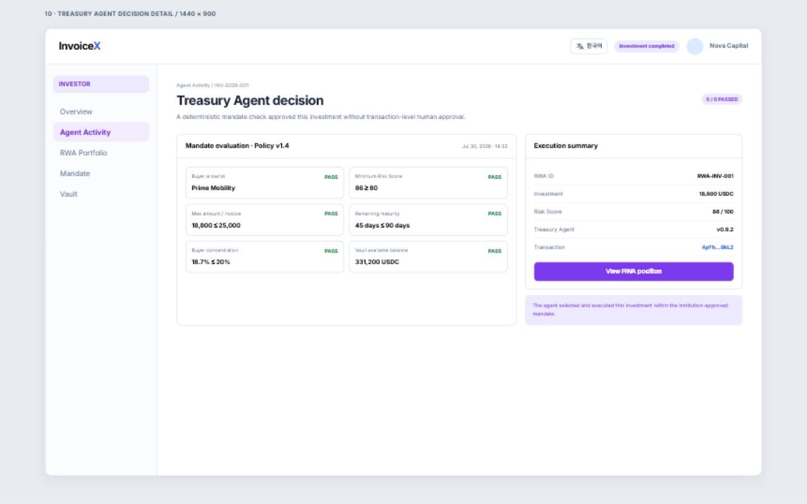

# InvoiceX — AI Treasury Agent for Invoice RWA

> **검증된 매출채권을 RWA로 발행하고, 투자자의 위임 한도 안에서 Treasury Agent가 자동으로 매수·정산하는 Solana 기반 B2B 금융 데모**

InvoiceX는 공급기업의 인보이스를 Gemini로 분석하고 구매기업의 확인을 거쳐, 해당 채권을 Solana Devnet의 RWA로 발행합니다. 투자자는 미리 서명한 Mandate(투자 정책)와 예치 USDC를 기준으로 두고, Treasury Agent는 조건을 충족한 RWA만 사람의 매 단계 승인 없이 자동 매수합니다.

이 프로젝트는 **Autonomous On-chain Settlement** 트랙을 위한 해커톤 MVP입니다. 실제 배포 환경, Cloud SQL·Cloud Storage·Secret Manager, Gemini 분석, Privy 서비스 지갑, Circle USDC Devnet 및 Solana 트랜잭션을 하나의 시나리오로 연결했습니다.

| 배포 데모 | API 상태 | 네트워크 |
| --- | --- | --- |
| [InvoiceX Web](https://invoicex-web-ew3oji7ara-du.a.run.app) | [Health check](https://invoicex-api-ew3oji7ara-du.a.run.app/api/v1/healthz) | Solana Devnet |

## 문제와 해결 방식

공급기업은 납품 후 만기까지 기다리는 동안 운전자금이 묶이고, 투자자는 어떤 매출채권에 얼마를 투자할지 매번 개별적으로 판단해야 합니다. InvoiceX는 이 사이를 다음처럼 연결합니다.

1. **공급기업**이 인보이스·계약서·발주서·납품 증빙을 올립니다.
2. **Gemini Document Agent**가 문서에서 핵심 필드를 추출하고, **Risk Agent**가 Risk Passport를 생성합니다.
3. **구매기업**이 문서 미리보기와 체크리스트를 통해 거래를 확인합니다.
4. 확인된 인보이스는 **1개 인보이스당 1개의 SPL 기반 RWA**로 발행되어 플랫폼 에스크로에 보관됩니다.
5. **투자자**는 허용 구매기업, 인보이스당 한도, 총 한도, 최소 위험 점수, 최대 잔존 만기 등을 담은 Mandate에 서명하고 USDC를 Agent Vault에 예치합니다.
6. **Treasury Agent**가 발행 RWA와 Mandate를 자동 평가합니다. 정책을 모두 통과하면 Agent Vault의 USDC를 공급기업 지갑으로 보내고, 에스크로의 RWA를 Agent Vault로 이전합니다.

즉, 투자자는 사전에 정한 정책만 승인하고, 이후의 RWA 매수 결정과 온체인 정산은 그 정책 범위 안에서 에이전트가 실행합니다.

## 데모 시나리오

### 역할별 경험

| 역할 | 주요 행동 | 생성되는 증적 |
| --- | --- | --- |
| 공급기업 | 인보이스 문서 4종 제출, 조기정산 조건 확인, RWA 발행 요청 | 문서 분석, Risk Passport, RWA mint / 발행 트랜잭션 |
| 구매기업 | 원본 문서 탭을 확인하고 거래·공급기업·금액·만기·납품·분쟁 여부를 검증 | 구매기업 확인 기록 |
| 투자자 | 투자 Mandate 서명, Devnet USDC 가스리스 예치, Agent 활동 조회 | 정책 서명, 예치 트랜잭션, 매수 결정·정산 트랜잭션 |

### 실제 자동매매 순서

1. 공급기업이 계약서, 발주서, 납품 증빙과 인보이스를 올리면 원본은 비공개 Cloud Storage에 저장됩니다.
2. 백엔드가 Gemini로 문서를 분석하고, 누락·불일치 신호와 위험 점수를 계산합니다.
3. 구매기업은 발행된 문서의 탭별 미리보기와 비교 체크리스트에서 거래 사실을 확인합니다.
4. 공급기업이 조기정산 오퍼를 수락하면 Issuer 지갑이 인보이스 단위 RWA를 발행해 Escrow에 보관합니다.
5. 투자자는 브라우저 지갑으로 Mandate에 서명하고 Circle USDC Devnet을 Treasury Agent Vault에 예치합니다. Sponsor 지갑이 Devnet SOL 수수료를 부담합니다.
6. Treasury Agent는 `policyActive`, 구매기업 allowlist, 최소 Risk Score, 잔존 만기, 인보이스별/총 투자 한도, Vault 잔액을 모두 검사합니다.
7. 모든 조건을 통과한 경우에만 Privy가 서비스 지갑 서명을 수행하고, **USDC는 공급기업으로 / RWA는 Agent Vault로** 같은 자동매매 단계에서 이전됩니다. 실행 결과와 체크 항목은 투자자 Activity 화면에 남습니다.

## 화면

| 공급기업 — 인보이스 현황 | 구매기업 — 원본 문서 확인 |
| --- | --- |
|  |  |

| 공급기업 — RWA 발행 전 검토 | 투자자 — Agent 결정 조회 |
| --- | --- |
|  |  |

## 실제 온체인 증적

아래 트랜잭션은 Solana **Devnet**에서 확인한 실제 실행 결과입니다. 데모 자산으로 검증한 것이므로 실제 금융상품 또는 Mainnet 거래를 의미하지는 않습니다.

| 이벤트 | 확인 내용 | Explorer |
| --- | --- | --- |
| RWA 발행 | `INV-2026-005`에 대응하는 1개 RWA 발행 및 Escrow 보관 | [발행 트랜잭션](https://explorer.solana.com/tx/3j5NnHwv5GmtokebAb1UYLmELdt559nECnkHqcR4tk4csFqadMFpNT6XhvikV3Hpj7HvkcMDwrqqoj2rMpiCY8h?cluster=devnet) |
| 자동 매수·공급기업 지급 | Treasury Agent Vault에서 공급기업 지갑으로 실제 USDC 전송 | [자동매매 트랜잭션](https://explorer.solana.com/tx/4ZfZV2TZ6ogbQBV46hzbSV5xZVDvgfTU1PNMvVRpLrExk92aCLZEZSBv7Vsq58pjbLwcYZSiWfvUH6xSaPU5shBn?cluster=devnet) |
| RWA Mint | 발행된 SPL Token mint | [`G6y2…X2im`](https://explorer.solana.com/address/G6y2k5DrGQdLyJX1wMh9RPRBtBBS5W1ZX5QUDHtmX2im?cluster=devnet) |

첫 자동매매 증적은 초기 데모 한도가 적용돼 **1 Devnet USDC**로 기록되어 있습니다. 현재 정책·실행 코드에서는 이 임시 1 USDC 상한을 제거했으며, 이후 실행 금액은 Mandate에 서명한 인보이스별 한도와 Vault 잔액을 따릅니다.

## 아키텍처

| 계층 | 사용 기술 | 역할 |
| --- | --- | --- |
| Web | React, TypeScript, Vite | 공급기업·구매기업·투자자 역할별 UI, 브라우저 지갑 연결, 상태·거래 증적 표시 |
| API / Agent | FastAPI, Pydantic, Python | 도메인 API, Document/Risk/Treasury Agent, 정책 검사, 감사 가능한 결정 결과 |
| AI | Google Gemini | 문서 4종의 멀티모달 분석, 필드 추출, 인보이스 위험 서술과 Risk Passport 생성 |
| 데이터 | Cloud SQL for PostgreSQL | 인보이스, 검증, Mandate, Vault, RWA, Agent Decision의 영속화 |
| 문서 저장소 | Google Cloud Storage | 비공개 원본 PDF·이미지 저장, 짧은 만료시간의 Signed URL로 구매기업 미리보기 제공 |
| 컨테이너 / 배포 / 보안 | Docker, Dockerfile, Cloud Run, Cloud Build, Artifact Registry, Secret Manager | Dockerfile로 Web·API 이미지를 빌드하고, 이미지 보관·Cloud Run 배포·환경별 비밀 주입을 수행 |
| 온체인 | Solana Devnet, Circle USDC Devnet, SPL Token, Privy | RWA mint·escrow, USDC 예치·지급, 서비스 지갑 서명, Sponsor 지갑 수수료 대납 |

### GCP 운영 구성

- **Docker / Cloud Build**: Web과 API의 Dockerfile로 컨테이너 이미지를 빌드하고, Cloud Build가 이를 Artifact Registry에 푸시합니다.
- **Artifact Registry / Cloud Run**: 저장된 컨테이너 이미지를 Cloud Run revision으로 배포해 Web과 API를 각각 실행합니다.
- **Cloud Run**: React Web과 FastAPI API를 별도 서비스로 배포했습니다. 프런트엔드 허용 Origin은 환경 변수로 관리합니다.
- **Cloud SQL**: 로컬 SQLite와 같은 aggregate 경계를 유지하면서 PostgreSQL JSONB 기반 영속화를 사용합니다.
- **Cloud Storage**: 문서는 공개 URL이 아닌 버킷 객체 경로로 보관하고, 조회 시에만 짧게 유효한 Signed URL을 만듭니다.
- **Secret Manager**: Gemini API key, Privy credential, Cloud SQL 비밀번호, 인증 비밀, RPC 설정을 코드와 Git에서 분리합니다.

## Mandate와 Treasury Agent

Mandate는 “에이전트가 어떤 자산을, 어느 조건까지, 누구의 자금으로 매수해도 되는지”를 사람이 한 번에 지정하는 정책 계약입니다. InvoiceX는 `InvoiceX AP2 Mandate` 형식의 canonical message에 지갑 서명을 받아 정책과 서명 증적을 함께 저장합니다.

현재 데모 정책에는 다음 항목이 포함됩니다.

- 총 투자 한도와 인보이스당 투자 한도
- 허용 구매기업 목록
- 최소 Risk Passport 점수
- 최대 잔존 만기
- Mandate 만료 시각

Treasury Agent는 단순 버튼 자동화가 아닙니다. RWA가 발행되거나 예치가 완료될 때 정책을 다시 평가하며, 각 조건의 통과/실패 결과와 실행 여부를 Agent Decision으로 기록합니다. 서명되지 않았거나 만료된 Mandate, 한도 초과, 구매기업 미허용, 위험 점수 미달, Vault 잔액 부족인 경우에는 USDC 전송을 실행하지 않습니다.

## 해커톤 심사 기준 대응

| 심사 기준 | InvoiceX의 구현 |
| --- | --- |
| 1. AI 활용도 (Gemini / Vertex AI) | Gemini Document Agent가 실제 제출 문서에서 거래 필드를 추출하고, Risk Agent가 Risk Passport와 리스크 서술을 생성합니다. 분석 결과는 구매기업 검증과 Agent 투자 정책의 입력값이 됩니다. |
| 2. Solana 온체인 구현 | Circle USDC Devnet 예치·공급기업 지급, 인보이스별 SPL Token RWA 발행·Escrow·이전, Solana Explorer에서 확인 가능한 실제 Devnet 트랜잭션을 구현했습니다. |
| 3. GCP 아키텍처 & 프로토콜 연동 | Cloud Run, Cloud SQL, Cloud Storage, Artifact Registry, Cloud Build, Secret Manager를 운영 경로에 연결했습니다. 투자 권한은 AP2-style signed Mandate로 표현했습니다. **x402 결제 플로우는 현재 데모 범위에 포함하지 않았습니다.** |
| 4. 상업성·기관 적용성 / UX·혁신성 | 공급·구매·투자 역할 분리, 원본 문서 검증, 정책 한도와 감사 가능한 Agent Decision, 비공개 문서 저장, Sponsor 지갑 기반 가스리스 Devnet UX를 제공합니다. **Passkey는 현재 구현 범위가 아닙니다.** |
| 5. 실제 온체인 실행 | 위 Explorer 링크의 RWA 발행 및 Treasury Agent 자동 USDC 지급은 Devnet에서 실제로 확인할 수 있습니다. |
| 가산점 | A2A, Solana Mobile, SendAI, cNFT 등은 현재 제출물의 구현 범위로 주장하지 않습니다. |

## 데모 범위와 의도적 제한

이 저장소는 심사에서 **실제 연결과 자동 실행의 핵심 경로**를 보여 주기 위한 MVP이며, 아래 제한은 의도적으로 남겨 두었습니다.

- **실제 인보이스 문서 기반**: 공급기업이 올린 인보이스·계약서·발주서·납품 증빙 4종을 문서 분석과 구매기업 확인 화면에 사용합니다. 다만 데모 자료는 테스트·시연 목적의 문서이며, 실거래 원본을 공개 저장소에 포함하지 않습니다.
- **소액 Devnet USDC**: 온체인 트랜잭션은 Circle USDC Devnet의 소액으로 실행합니다. 자금 손실 없이 서명·수수료 대납·USDC 이전·RWA 이전을 검증하기 위한 설정이며, 실제 투자금이나 Mainnet 유동성을 뜻하지 않습니다.
- **만기 상환·원화 환전은 범위 밖**: 구매기업의 만기 원화 입금, KRW↔USDC 환전, 투자자 상환 배분은 핵심 자동매수 MVP 이후의 정산 단계로 남겨 두었습니다. 현재 데모의 핵심은 **정책 기반 RWA 자동 매수와 공급기업 조기 지급**입니다.
- **SPL Token RWA 데모**: 인보이스당 1개 토큰을 발행하는 구조로 권리와 거래 흐름을 검증합니다. 법적 권리 이전, 수탁, KYC/AML, 규제 심사, 기관용 한도·회계는 상용화 전에 별도 설계와 검증이 필요합니다.
- **프로토콜 범위**: AP2-style 서명 Mandate는 구현했지만, x402·A2A·Passkey·Solana Mobile은 이번 MVP의 구현 범위가 아닙니다.

## 보안 원칙

- 개인키·시드 문구·Privy App Secret·Gemini API key·DB 접속 정보는 코드와 Git에 저장하지 않습니다.
- 외부 사용자의 지갑 서명은 브라우저 지갑에서 수행하며, 서비스 지갑의 개인키는 Privy 밖으로 내보내지 않습니다.
- Sponsor 지갑이 Devnet SOL 수수료를 내므로 사용자 경험은 가스리스이지만, 수수료 지급 지갑과 권한은 서버 측 환경 변수 및 Secret Manager로만 관리합니다.
- 원본 문서는 비공개 Cloud Storage에 두고, 필요한 시점에만 만료되는 Signed URL을 제공합니다.

---

Built for **Autonomous On-chain Settlement** · Gemini × Google Cloud × Solana Devnet
