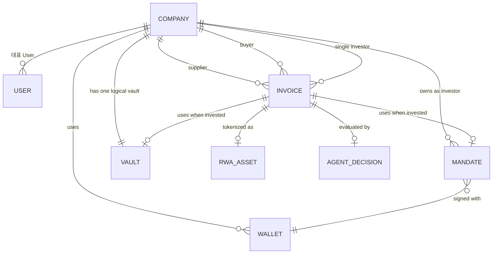

# Privy 회원가입 도입을 위한 InvoiceX MVP 백엔드 구조 재설계

> 상태: 설계 결과 — 구현하지 않음  
> 목적: Google × Solana Hackathon MVP에서 Privy Auth를 안전하게 붙이기 위한 최소 DB·Backend 구조

## 한 줄 결론

이번 MVP에서는 **한 User가 한 Company를 대표**하게 하고, Company가 Invoice·Mandate·Vault의 소유자가 된다. 복잡한 CompanyMembership, InvestmentAccount, 독립 Investment 테이블은 만들지 않는다.

Investor도 법인이며, 한 Investor Company는 하나의 논리 Vault와 하나의 활성 Mandate를 가진다. 한 Invoice에는 한 Investor Company만 투자하므로, 투자 관계는 별도 Investment 테이블 대신 Invoice에 직접 기록한다.

## 확정 정책 반영

| 정책 | MVP 설계 반영 |
| --- | --- |
| Investor는 법인만 존재 | 개인 투자자·개인용 InvestmentAccount는 만들지 않는다. Investor Company가 투자 주체다. |
| Privy Embedded Wallet + 외부 Solana Wallet 허용 | Wallet 테이블 하나로 두 지갑 유형을 관리한다. |
| 한 Invoice에 복수/분할 투자 없음 | Invoice에 investor_company_id를 직접 둔다. 별도 Investment 테이블은 만들지 않는다. |
| Vault는 투자계정별 분리 | MVP에서는 Investor Company마다 Vault 행 하나를 만든다. 실제 Solana token account 분리는 이번 범위가 아니다. |
| Company 가입은 self-serve + 자동 승인 | Privy 인증 후 Company와 대표 User를 즉시 생성한다. 초대/승인 workflow는 만들지 않는다. |

## 1. 현재 Backend 구조

현재 backend는 FastAPI와 SQLite/Cloud SQL PostgreSQL repository를 사용하며, ORM migration이 아니라 repository의 직접 SQL과 JSON document 저장을 사용한다.

- auth.py: 세 개의 고정 데모 계정으로 HMAC bearer token을 발급한다. token에는 role과 email만 있다.
- api.py: Supplier/Buyer/Investor 역할만 검사한다. Company나 리소스 소유자 검사는 없다.
- repository.py: invoices, mandates, vaults, rwa_assets, agent_decisions 등을 주로 JSON document로 저장한다.
- models.py: Invoice 안에 supplier, buyer, investor party와 RWA/decision/transaction이 함께 들어 있다.
- service.py: Mandate와 Vault를 owner_wallet_address로 찾는다.
- solana.py: Privy는 이미 Treasury/Agent Vault, Issuer, Sponsor 같은 **서버 서비스 지갑** 서명에 사용된다.

현재의 가장 큰 문제는 로그인한 사람/회사와 Invoice·Mandate·Vault의 소유 관계가 DB에 없다는 점이다. 역할이 맞으면 같은 역할의 다른 회사 데이터까지 접근할 수 있는 형태다.

## 2. 회원가입 도입 시 반드시 바뀌는 부분

| 현재 | 문제 | MVP 변경안 |
| --- | --- | --- |
| 데모 email/password + HMAC token | 실제 Privy 사용자와 연결되지 않음 | Privy token을 서버에서 검증하고 privy_user_id로 User 조회 |
| LoginRole 하나 | 사람·회사·업무 권한이 섞임 | User의 company_id와 Company.type으로 단순화 |
| Invoice party가 JSON 속 이름/주소 | DB 소유자 검증 불가 | Invoice에 supplier_company_id, buyer_company_id, investor_company_id 추가 |
| Mandate/Vault가 wallet 주소 소유 | 지갑을 바꾸면 소유권이 흔들림 | Mandate/Vault는 investor_company_id 소유 |
| profile_wallets의 전역 역할 주소 | 실제 회사별 지갑을 표현 못함 | 회사별 Wallet 행으로 교체 |
| Investment가 없음 | 현재는 분산돼 있지만, 한 Invoice=한 투자라면 별도 aggregate는 과함 | Invoice가 투자 상태와 investor_company_id를 직접 보유 |

## 3. MVP 최종 데이터 구조

### 반드시 필요한 Entity

| Entity | 핵심 필드 | 왜 필요한가 |
| --- | --- | --- |
| User | id, privy_user_id, email, company_id | Privy 로그인 주체와 대표자를 식별하고 누가 요청했는지 남긴다. |
| Company | id, name, type(SUPPLIER/BUYER/INVESTOR), created_at | Invoice·Mandate·Vault의 업무상/법인상 소유자다. |
| Wallet | id, company_id, address, wallet_type(EMBEDDED/EXTERNAL), privy_wallet_id nullable, is_primary | 한 회사가 embedded와 외부 지갑을 모두 등록할 수 있다. |
| Invoice | 기존 JSON document + supplier_company_id, buyer_company_id, investor_company_id nullable, selected_investor_wallet_id nullable | 거래 당사자와 단일 투자자를 확실히 연결한다. |
| Mandate | 기존 값 + investor_company_id, signing_wallet_id | 투자 정책의 소유자를 지갑이 아니라 Investor Company로 만든다. |
| Vault | 기존 값 + investor_company_id UNIQUE | Investor Company별 논리 잔액/Vault를 분리한다. |

기존 RwaAsset, AgentDecision, Verification, document analysis, agent run은 유지한다. 이들은 계속 Invoice ID에 연결된다.

### 이번 MVP에서 만들지 않는 Entity

| 제외 Entity | 제외 이유 |
| --- | --- |
| CompanyMembership | 한 User가 한 Company의 대표자로 가입하고 초대·복수 담당자를 지원하지 않으므로 불필요하다. User.company_id면 충분하다. |
| InvestmentAccount | Investor가 법인뿐이고 법인당 하나의 Vault/Mandate만 사용하므로 Company와 1:1인 중간 개체는 중복이다. |
| Investment | Invoice당 단일 투자이므로 investor_company_id, mandate_id, vault_id, 투자 상태를 Invoice에 두면 된다. |
| wallet ownership/proof 권한 테이블 | 여러 owner, 권한 위임, wallet rotation은 이번 범위가 아니다. 외부 지갑 연결 시 서명 검증만 수행한다. |
| vault ledger / custody accounting | 해커톤 MVP에는 과하다. 현재 잔액과 체인 확인 흐름을 유지한다. |

## 4. Entity 관계도



가입 흐름은 다음처럼 단순하다.

```text
Privy 로그인
  → backend가 token 검증
  → User 없음?
      → Company 생성(type 선택)
      → User 생성(company_id = 새 Company)
      → 선택한 embedded/external wallet 등록
  → User 있음?
      → company_id 기준으로 현재 Company 사용
```

## 5. InvestmentAccount 필요 여부

### 유지한다면

Investor Company와 1:1인 InvestmentAccount가 생기고, Vault/Mandate/Investment가 이를 참조하게 된다. 나중에 한 법인이 여러 펀드·계정을 운영하기에는 좋다.

### 제거한다면 — **MVP 권장**

이번 정책에서는 Investor가 법인이고, 법인당 하나의 논리 Vault와 하나의 활성 Mandate만 필요하다. 이때 InvestmentAccount는 Company를 한 번 더 감싼 이름뿐인 테이블이 된다.

따라서 이번 MVP에서는 제거한다.

- Mandate.investor_company_id
- Vault.investor_company_id UNIQUE
- Invoice.investor_company_id

로 충분하다. 여러 투자계정이 실제 요구사항으로 생길 때에만 InvestmentAccount를 추가한다.

## 6. 기존 DB에서 변경될 부분

기존 JSON 구조를 유지하고, 필요한 소유 관계 열만 추가하는 방향이다.

| 기존 테이블/값 | MVP 변경 |
| --- | --- |
| 없음 | users, companies, wallets 추가 |
| invoices(id, document) | supplier_company_id, buyer_company_id, investor_company_id nullable, mandate_id nullable, vault_id nullable 추가 |
| mandates(id, owner_wallet_address, document) | investor_company_id, signing_wallet_id 추가. owner_wallet_address는 호환 기간 유지 가능 |
| vaults(owner_wallet_address, document) | id, investor_company_id UNIQUE 추가. 기존 주소는 vault address/data로 유지 |
| profile_wallets(role, wallet_address) | 신규 wallet로 대체 예정. 더 이상 역할별 전역 주소를 쓰지 않음 |
| rwa_assets / agent_decisions | Invoice ID 연결은 그대로 유지. 투자자가 정해진 경우 Invoice의 investor_company_id를 통해 소유자를 찾음 |

MVP에서는 Invoice document 안의 supplier/buyer/investor party를 즉시 정규화하거나 삭제하지 않는다. 새 Company FK를 권한과 조회 필터의 기준으로 사용하고, 기존 JSON은 화면/도메인 데이터 호환용으로 남긴다.

## 7. Auth 흐름

1. 사용자가 Privy로 로그인하거나 가입한다.
2. frontend는 Privy access token을 Authorization bearer header로 보낸다.
3. backend는 Privy token을 서버에서 검증한다.
4. 검증된 Privy subject로 User를 찾는다.
5. User가 없으면 self-serve 가입 payload로 Company와 대표 User를 만든다.
6. backend는 user_id, company_id, company_type을 담은 내부 principal을 만든다.
7. 모든 업무 API는 이 principal에서 Company를 가져온다.

중요한 점은 request body의 companyId, role, walletAddress를 권한의 근거로 쓰지 않는 것이다. 사용자 입력은 선택값일 뿐이며, 서버 principal과 DB 관계가 일치할 때만 사용한다.

## 8. API 권한 구조

별도의 복잡한 RBAC 없이 Company 소유 비교만 한다.

| 기능 | 허용 조건 |
| --- | --- |
| Invoice 생성 | principal Company.type이 SUPPLIER |
| Invoice 목록 | supplier_company_id, buyer_company_id, investor_company_id 중 하나가 principal.company_id |
| Invoice 상세 | 목록과 같은 Company 소유 조건 |
| Buyer verification | Invoice.buyer_company_id가 principal.company_id |
| Supplier offer/정산 | Invoice.supplier_company_id가 principal.company_id |
| Mandate 생성/조회 | principal Company.type이 INVESTOR이며 mandate.investor_company_id가 동일 |
| Vault 조회/예치 | principal Company.type이 INVESTOR이며 vault.investor_company_id가 동일 |
| 투자 실행 | Investor Company의 Mandate/Vault가 있고 Invoice.investor_company_id가 비어 있을 때만 연결 |

MVP에서 같은 Company 안의 여러 User를 지원하지 않으므로 User-level 세분 권한은 필요 없다.

## 9. Wallet 구조

Wallet은 사람의 계정이 아니라 **대표 User가 등록한 Company 사용 지갑**으로 저장한다.

```text
wallets(
  id,
  company_id,
  address,
  wallet_type,       -- EMBEDDED 또는 EXTERNAL
  privy_wallet_id,   -- embedded일 때 사용, external이면 null 가능
  is_primary,
  created_at,
  UNIQUE(address)
)
```

- EMBEDDED: Privy가 제공한 wallet ID/address와 로그인 User의 Privy identity가 일치하는지 확인한다.
- EXTERNAL: 주소를 등록하기 전에 backend nonce에 대한 Solana 서명을 검증한다.
- Mandate는 signing_wallet_id를 저장한다.
- 입출금/수취에 사용할 기본 지갑은 is_primary로 선택할 수 있다.
- Treasury/Issuer/Sponsor 서비스 지갑은 지금처럼 환경설정/Secret Manager로 관리하며, 이 wallets 테이블에 Company 지갑으로 넣지 않는다.

외부 지갑 서명 검증은 복잡한 권한 시스템이 아니라, 다른 회사 지갑 주소를 무단 등록하지 못하게 하는 MVP 최소 안전장치다.

## 10. 최소 Migration Plan

실제 production migration이나 SQL 작성은 이번 범위가 아니다. 해커톤 MVP 최소 순서는 다음과 같다.

1. 기존 DB를 백업한다.
2. users, companies, wallets 테이블과 Invoice/Mandate/Vault의 Company FK 열을 추가한다.
3. 기존 데모 Supplier/Buyer/Investor를 각각 Company 하나와 대표 User 하나로 seed/mapping한다.
4. 기존 demo invoice의 supplier/buyer/investor party를 해당 Company FK에 연결한다.
5. Privy token 검증과 self-serve Company/User 생성 흐름을 추가한다.
6. API의 require_roles를 principal.company_id 기반 소유 검사로 바꾼다.
7. profile_wallets와 데모 login은 새 흐름이 확인된 뒤 제거한다.

기존 데이터가 demo seed뿐이라면 3~4단계는 복잡한 dual-read/backfill 대신 명시적인 seed 재생성으로 처리해도 된다. 실제 고객/체인 데이터가 있다면 삭제가 아니라 작은 mapping script와 row-count 검증을 먼저 수행해야 한다.

## 11. 지금 해야 할 것 / 나중에 해야 할 것

### Google × Solana Hackathon MVP에서 필요

- Privy token의 서버 검증
- User 1명 = Company 1개 대표자 모델
- Company.type: SUPPLIER, BUYER, INVESTOR
- Company별 embedded/external Wallet 등록
- 외부 wallet 등록의 nonce 서명 검증
- Invoice/Mandate/Vault의 Company FK
- Company 소유 기반 API 필터와 검사
- Investor Company별 논리 Vault 한 개
- Invoice당 Investor Company 한 개만 허용하는 DB/API 검사

### 본선 이후 실제 서비스 단계

- CompanyMembership, 초대, 담당자 교체, 한 User의 복수 Company
- 여러 InvestmentAccount와 법인 내 자금 계정 분리
- 분할 투자와 독립 Investment/Position 테이블
- vault ledger, 실제 custody/token account 분리, 회계 reconciliation
- KYC/사업자 검증, MFA, 관리자 승인
- wallet rotation/revocation, 다중 서명자·권한 위임
- webhook 기반 계정 상태 동기화, 감사/보존 정책

## 향후 필요하지만 이번 MVP에서 구현하지 않는 안전장치

- Privy token issuer/audience/JWKS 검증 실패 처리와 key rotation
- 외부 wallet 연결 해제·분실 대응
- 온체인 transaction idempotency와 재시도 제어
- vault 잔액과 실제 체인 잔액 reconciliation
- 회사 가입 정보의 사업자/KYC 검증
- Company 대표자 변경 및 감사 로그

## 최종 목표

회원가입 후 사용자는 자신이 대표하는 Company로 즉시 업무를 시작한다. Supplier/Buyer/Investor는 모두 Company이며, Invoice·Mandate·Vault는 반드시 하나의 Company에 귀속한다.

이 구조는 현재 MVP에 필요한 Privy Auth, 회사 분리, 두 종류의 Solana 지갑, 단일 Invoice 투자만 해결한다. 여러 담당자, 여러 펀드 계정, 분할 투자, 실제 수탁·회계는 필요해질 때 추가한다.

