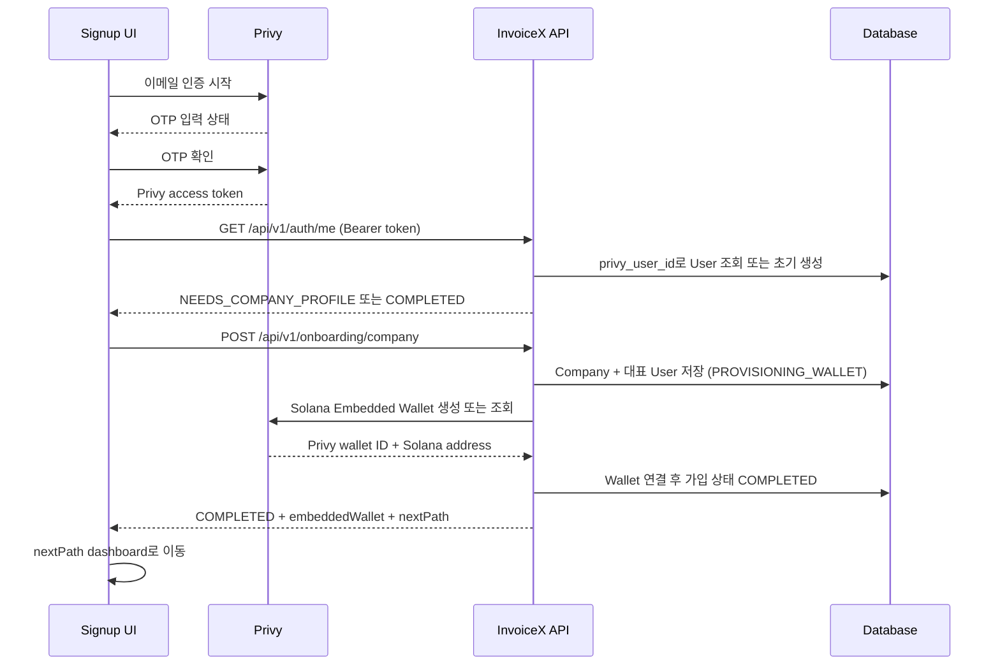

# 회원가입 UI 기준 Privy API 설계

> 상태: 설계안 — 구현하지 않음  
> 기준 화면: frontend/src/pages/SignupPage.tsx  
> 범위: 현재 확정된 회원가입 UI가 실제로 호출해야 하는 Backend API와, 이후 지갑 등록에 필요한 최소 API

## 결론

현재 회원가입 화면에 **지금 필요한 Backend API는 두 개**다.

1. Privy 인증 후 현재 사용자와 가입 완료 여부를 확인하는 API
2. 기업 정보 입력 마지막 단계에서 Company·대표 User·Privy Solana Embedded Wallet을 만드는 API

이메일 인증 코드 발송·검증 API는 만들지 않는다. 해당 단계는 Privy의 이메일 인증 UI/SDK로 처리하고, Backend는 Privy access token만 검증한다.

현재 화면에는 지갑 선택/연결 단계가 없으며, 이는 의도된 정책이다. 기업 정보 등록이 성공하면 Backend가 Privy를 통해 Solana Embedded Wallet을 자동 생성·연결하고, 이 작업까지 성공한 뒤에만 dashboard로 이동한다. External wallet만 이후 Profile의 Wallet 영역에서 선택적으로 연결한다.

## 1. 현재 UI 분석

SignupPage의 실제 흐름은 다음과 같다.

```text
기업 이메일 입력
  → 6자리 인증 코드 입력
  → 기업 유형 선택 (supplier | buyer | investor)
  → 기업 정보 입력
      - 기업명
      - 사업자등록번호
      - 담당자명
      - 담당자 직책
      - 담당자 연락처
  → 가입 완료
  → 역할별 dashboard 이동
```

확인한 현재 상태:

- /signup은 아직 Backend API를 호출하지 않고 단계 state만 변경한다.
- 이메일 code 재전송도 UI state 초기화만 한다.
- 가입 완료를 누르면 저장 없이 곧바로 완료 화면으로 간다.
- 완료 후 supplier/buyer/investor route는 프론트의 dashboardRoutes로 정한다.
- 기업명, 담당자명, 담당자 직책만 state가 있다.
- 사업자등록번호와 담당자 연락처 input은 아직 state/FormData에 넣지 않으므로 API 연결 전 보완이 필요하다.
- frontend package에는 Privy 클라이언트 SDK가 아직 없다.
- 현재 auth.api.ts와 demoAccounts.ts는 고정 데모 로그인/HMAC token 방식이다.

## 2. 책임 분리

| 단계 | 담당 | Backend API 필요 여부 |
| --- | --- | --- |
| 이메일 입력과 6자리 code 발송 | Privy 클라이언트 인증 | 없음 |
| code 검증, Privy session/access token 발급 | Privy 클라이언트 인증 | 없음 |
| Privy token의 유효성 검증 | Backend | 모든 보호 API에서 수행 |
| 신규/기존 사용자 및 가입 상태 판별 | Backend | 필요 |
| Company와 대표 User 생성 | Backend | 필요 |
| Embedded wallet 자동 생성·연결 | Backend + Privy server integration | 기업 가입 완료 API 안에서 처리 |
| External wallet 연결 | 이후 Profile Wallet UI + Backend | 현재 signup 화면에는 불필요 |

즉, 현재의 이메일/code UI는 유지할 수 있지만 버튼 동작은 Privy SDK에 연결해야 한다. Backend가 별도의 인증 코드를 발송하거나 이메일 비밀번호를 저장해서는 안 된다.

## 3. 가입 완료 전후 흐름



Backend는 Privy token의 subject를 User 식별 기준으로 사용한다. request body에 email, privyUserId, companyId를 받아서 신뢰하지 않는다.

## 4. 필수 API 1 — 현재 로그인 사용자 조회

### GET /api/v1/auth/me

**용도**

- Privy 인증 직후 신규/기존 사용자를 판별한다.
- 앱 시작 시 로그인 상태와 Company 정보를 복원한다.
- 가입이 완료된 사용자를 /signup 대신 알맞은 dashboard로 보낸다.

**인증**

```http
Authorization: Bearer <Privy access token>
```

**응답: 가입 전**

```json
{
  "user": {
    "id": "usr_01H...",
    "email": "finance@acme.co.kr",
    "name": null,
    "title": null,
    "phone": null
  },
  "company": null,
  "onboardingStatus": "NEEDS_COMPANY_PROFILE",
  "nextPath": "/signup"
}
```

**응답: 가입 완료**

```json
{
  "user": {
    "id": "usr_01H...",
    "email": "finance@acme.co.kr",
    "name": "홍길동",
    "title": "재무팀 매니저",
    "phone": "010-0000-0000"
  },
  "company": {
    "id": "cmp_01H...",
    "name": "에이씨미 주식회사",
    "type": "SUPPLIER",
    "businessRegistrationNumberMasked": "123-**-*****"
  },
  "onboardingStatus": "COMPLETED",
  "nextPath": "/supplier"
}
```

**처리 규칙**

- 유효한 Privy token은 있으나 users 행이 없으면, Backend는 privy_user_id와 검증된 이메일로 최소 User 행을 생성한다. 이 User의 상태는 NEEDS_COMPANY_PROFILE이다.
- Company를 자동 생성하지는 않는다. Company 정보는 사용자가 마지막 가입 화면에서 제출할 때만 만든다.
- 가입이 끝난 User가 /signup에 들어오면 frontend는 nextPath로 redirect한다.
- token이 없거나 검증 실패면 401이다.

## 5. 필수 API 2 — 기업 가입 완료

### POST /api/v1/onboarding/company

**용도**

현재 SignupPage의 “기업 등록 완료” 버튼이 호출한다. Backend는 Company와 대표 User를 저장한 뒤, 해당 Privy User의 Solana Embedded Wallet을 자동 생성·연결한다. 이 전체 흐름이 성공한 경우에만 완료 화면과 dashboard 이동을 보여준다.

**인증**

```http
Authorization: Bearer <Privy access token>
Content-Type: application/json
```

**요청**

```json
{
  "company": {
    "name": "에이씨미 주식회사",
    "type": "SUPPLIER",
    "businessRegistrationNumber": "123-45-67890"
  },
  "representative": {
    "name": "홍길동",
    "title": "재무팀 매니저",
    "phone": "010-0000-0000"
  }
}
```

**필드 출처**

| API 필드 | SignupPage의 값 | 저장 위치 |
| --- | --- | --- |
| company.name | 기업명 | Company |
| company.type | 공급기업/구매기업/투자기관 선택 | Company |
| company.businessRegistrationNumber | 사업자등록번호 | Company |
| representative.name | 담당자명 | User |
| representative.title | 담당자 직책 | User |
| representative.phone | 담당자 연락처 | User |
| User.email | Privy token의 검증된 email | User |
| User.privy_user_id | Privy token subject | User |

담당자 정보는 Company에 중복 저장하지 않는다. 이번 MVP에서는 가입한 User가 그 Company의 대표자이므로 User profile에 저장한다.

**성공 응답: 201 Created**

```json
{
  "user": {
    "id": "usr_01H...",
    "email": "finance@acme.co.kr",
    "name": "홍길동",
    "title": "재무팀 매니저",
    "phone": "010-0000-0000"
  },
  "company": {
    "id": "cmp_01H...",
    "name": "에이씨미 주식회사",
    "type": "SUPPLIER",
    "businessRegistrationNumberMasked": "123-**-*****"
  },
  "embeddedWallet": {
    "id": "wal_01H...",
    "type": "EMBEDDED",
    "address": "SolanaAddress...",
    "status": "ACTIVE"
  },
  "onboardingStatus": "COMPLETED",
  "nextPath": "/supplier"
}
```

**서버 처리 순서**

1. Privy token의 subject로 아직 가입 완료되지 않은 User인지 확인한다.
2. Company와 대표 User 정보를 저장하고 onboarding 상태를 PROVISIONING_EMBEDDED_WALLET로 둔다.
3. Backend의 Privy server integration으로 해당 User의 Solana Embedded Wallet을 생성한다. 이미 생성된 경우에는 같은 wallet을 조회한다.
4. Privy wallet ID와 Solana address를 내부 Wallet 행으로 저장하고 Company에 연결한다.
5. Wallet 연결이 성공한 경우에만 onboardingStatus를 COMPLETED로 변경하고 응답한다.

Privy 호출과 DB transaction은 하나의 기술적 transaction으로 묶을 수 없으므로, 중간 실패 시 Company를 중복 생성하지 않는다. 같은 User의 재시도는 기존 PROVISIONING 상태를 이어서 wallet 생성/조회만 재개해야 한다.

**검증 및 오류**

| HTTP | 오류 code | UI 처리 |
| --- | --- | --- |
| 401 | PRIVY_TOKEN_INVALID | 로그인/이메일 인증 단계로 복귀 |
| 409 | ONBOARDING_ALREADY_COMPLETED | GET /auth/me 결과의 nextPath로 이동 |
| 409 | BUSINESS_REGISTRATION_ALREADY_USED | 사업자등록번호 입력칸에 안내 |
| 422 | VALIDATION_ERROR | 해당 입력칸에 필드 오류 표시 |
| 429 | RATE_LIMITED | 잠시 후 재시도 안내 |
| 502 | EMBEDDED_WALLET_PROVISIONING_FAILED | Company 정보는 보존하고, “다시 시도”로 wallet 생성/연결을 재개 |
| 500 | INTERNAL_ERROR | 저장 실패 안내, form 값 유지 |

같은 Privy User가 네트워크 재시도로 이 API를 두 번 호출해도 Company나 Embedded Wallet을 두 개 만들면 안 된다. 이미 가입 완료라면 새 Company를 만들지 않고 409을 반환하고 frontend는 GET /auth/me의 nextPath로 이동한다. wallet 생성 중 상태라면 같은 요청은 생성이 아니라 기존 wallet 조회/연결 재시도로 처리한다.

## 6. UI 연결 규칙

| 현재 UI 이벤트 | 실제 연결 대상 |
| --- | --- |
| “인증 코드 받기” | Privy 이메일 인증 시작 |
| 6자리 code 입력 후 “인증 완료” | Privy code 검증 성공 시 GET /auth/me |
| “코드를 받지 못하셨나요? 재전송” | Privy code 재발송 |
| 기업 유형 선택 | local state만 변경 |
| “기업 등록 완료” | POST /api/v1/onboarding/company; Company 저장 후 Embedded Wallet 자동 생성/연결 |
| 완료 화면 “InvoiceX 시작하기” | Embedded Wallet까지 포함한 API 응답의 nextPath로 이동 |

현재 프론트의 dashboardRoutes mapping은 API 응답의 nextPath를 우선 사용하도록 바꾸는 편이 안전하다. type-to-route 규칙이 두 곳에 중복되지 않는다.

API 연결 전에 SignupPage에 반드시 추가되어야 하는 프론트 상태는 아래 세 개다.

```text
businessRegistrationNumber
contactPhone
submitError / isSubmitting
```

businessRegistrationNumber와 contactPhone은 현재 화면에 이미 있는 입력값이며, state 또는 FormData로 보관해 POST /api/v1/onboarding/company 요청에 반드시 포함한다. submitError와 isSubmitting은 wallet 자동 생성이 끝날 때까지 중복 제출과 잘못된 dashboard 이동을 막는다.

## 7. 자동 Embedded Wallet과 후속 External Wallet API

회원가입 UI에 wallet 단계는 없다. Embedded Wallet은 POST /api/v1/onboarding/company 내부에서 Backend가 Privy server integration으로 자동 생성·연결한다. 따라서 frontend가 호출하는 POST /api/v1/wallets/embedded는 MVP에 필요하지 않다.

자동 생성은 사용자 액션이 아니라 가입 완료의 일부다. Backend는 Privy User와 생성된 wallet의 소유 관계를 확인한 뒤, Privy wallet ID와 address를 저장한다. address만 프론트에서 받아 등록하는 방식은 사용하지 않는다.

External wallet은 회원가입과 분리한다. 이후 Profile의 Wallet 영역을 연결할 때 아래 API를 추가한다.

| API | 목적 |
| --- | --- |
| GET /api/v1/wallets | 현재 Company에 등록된 지갑 목록 |
| POST /api/v1/wallets/external/challenge | 외부 Solana 지갑 소유 증명용 nonce/message 발급 |
| POST /api/v1/wallets/external/confirm | address, challengeId, signature를 검증하고 지갑 등록 |
| PATCH /api/v1/wallets/{walletId}/primary | Company의 기본 지갑 선택 |

### External wallet challenge/confirm 예시

```http
POST /api/v1/wallets/external/challenge
```

```json
{ "address": "SolanaAddress..." }
```

```json
{
  "challengeId": "wch_...",
  "message": "InvoiceX wallet ownership\nNonce: ...",
  "expiresAt": "2026-08-18T12:00:00Z"
}
```

```http
POST /api/v1/wallets/external/confirm
```

```json
{
  "challengeId": "wch_...",
  "address": "SolanaAddress...",
  "signature": "base64..."
}
```

이 nonce 서명 검증은 다른 Company 지갑을 주소만으로 가로채 등록하지 못하게 하는 최소 안전장치다. 다중 서명자·권한 위임·wallet rotation은 MVP 범위가 아니다.

## 8. 기존 API와의 연결 영향

회원가입 API만 추가해도 현재 dashboard API는 아직 데모 role과 wallet address를 기준으로 동작한다. 실제 가입 계정을 사용하려면 후속 구현에서 다음을 바꿔야 한다.

- demoAccounts.ts의 token 저장/헤더 생성은 Privy token getter로 교체한다.
- 기존 POST /api/v1/auth/login은 데모 전용으로 격리하거나 제거한다.
- require_roles는 principal.company_id와 Company.type을 기준으로 바꾼다.
- Invoice 조회는 supplier_company_id, buyer_company_id, investor_company_id 중 현재 Company와 일치하는 항목만 반환한다.
- Mandate/Vault API의 ownerWalletAddress query/body는 없애고 현재 Company의 Mandate/Vault를 서버에서 찾는다.
- 현재 investor wallet deposit UI가 보내는 address는 등록된 Company wallet인지 먼저 확인한다.

이 작업은 signup 페이지 API 설계의 직접 범위는 아니지만, 가입을 완료한 실제 사용자가 dashboard에서 데이터를 보려면 반드시 이어져야 한다.

## 9. 구현 순서

1. Privy frontend 인증 연동과 token 확보
2. GET /api/v1/auth/me
3. POST /api/v1/onboarding/company
4. SignupPage의 입력 state, loading/error, 실제 API 호출 연결
5. Company principal 기반 보호 API 전환
6. 이후 Profile Wallet UI와 External Wallet API 연결

## 확정된 MVP 정책

- 사업자등록번호는 전역 unique로 관리하며, 이미 등록된 번호로는 가입할 수 없다.
- 동일 Privy User는 재가입할 수 없다. 복수 담당자와 Company Member 기능은 지원하지 않는다.
- Solana Embedded Wallet은 회원가입 완료 과정에서 모든 User에게 자동 생성·연결한다. 별도 선택 UI나 사용자 액션 API는 없다.
- External Solana Wallet은 가입 후 Profile의 Wallet 영역에서 선택적으로 연결한다.
- Company.type은 가입 이후 변경할 수 없다. 변경이 필요하면 새 Company 가입으로 처리한다.

